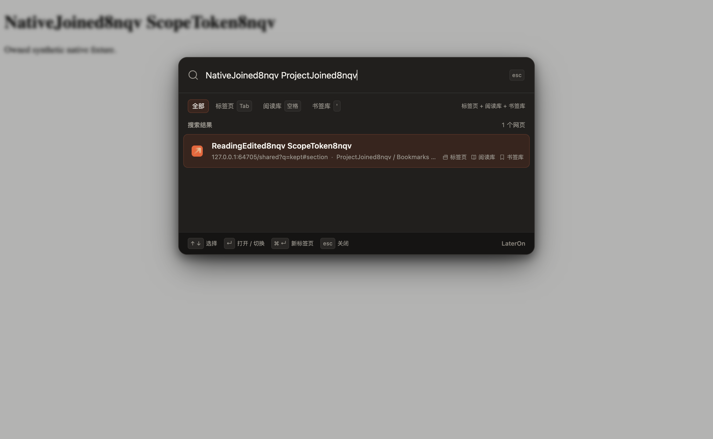

# Quick Switcher 模式与 favicon 验证

2026-11-08，正式版 `1.74.4`。本轮基于已发布的 `52623b1` 开发，新增网站 favicon、四种可配置来源组合和引导符。下述回归与原生证据记录用户已验收的 `1.74.4-test.1`；正式版沿用其功能代码，仅移除 manifest 的测试显示标记。原始报告保留测试版名称与哈希。

默认唤起搜索标签页、阅读库和书签库；搜索框内 Tab 默认选择标签页，开头空格选择阅读库，开头 `'` 选择书签库。每种模式可选择三个来源的任意非空组合，后三个引导符可修改。配置四行一起保存，重置先恢复草稿；每次重开回到配置的默认模式。

## 原生 Chrome 结果

隔离配置使用 Chrome `156.0.8078.80`、macOS、本地扩展安装和真实 Chrome storage、tabs、windows、bookmarks、favicon API。原生书签为 50,000 条，Reading 为 5,000 条；验收额外加入 202 个 Reading 记录、两个原生书签及三个测试标签页。同网址按完整 query、fragment 去重。

[原始原生报告](quick-switcher-native-1.74.4-test.1.json) 20 项全部通过，`errors=[]`。验收包括：

- 七种非空来源组合在同一专用检索词下分别返回 2、202、2、203、3、203、204 个去重结果；最多显示 50 行。只显示所选来源的标题、归属和标记。
- 多词跨原生标签标题与 Reading 项目匹配，即使各来源单独不匹配，也返回正确的同网址记录；Reading 手动标题优先。共享记录位于库内首批 50 行之外仍可合并并统计一次。
- 设置通过实际后台 RPC 保存；与主题并发保存不互相覆盖。重新加载设置页后保留 `/` 等自定义前缀和重新分配的 Tab，引导符切换保留查询。
- 精确 URL 的库记录激活既有标签，并从另一正常窗口切换焦点；已跳转或关闭的单纯标签结果被拒绝，操作前后的原生 ID/URL 集合没有增加旧页面。
- 禁用书签及更改同步范围后，搜索和旧结果打开遵守当前范围。
- 删除旧 schema-5 来源视图后先返回真实临时书签结果，后台完成升级、发布新代并清空待处理标记，随后精确查询。schema 保持 5。
- 本地测试站点的 favicon 由真实 Chrome `_favicon/` 缓存端点返回，容器透明。图标加载不参与输入或结果就绪等待。

测试过程中没有向扩展 service worker 附加 debugger。停止后台场景使用 `Target.closeTarget` 强制停止并确认目标不存在，随后通过网页内客户端消息唤起；系统 Alt/Option+O 本身未由 CDP 触发。

## 大库时延

完整索引已准备好时，五次真实网页唤起均得到正常结果，UI 没有显示临时更新状态。每次查询回复与当时 META 的 generation/revision 一致，待处理标记为空；运行中场景三次、强制停止后台场景两次。

| 指标 | 原始值 | 中位数 |
| --- | --- | --- |
| 输入框获得焦点，五次 | 40.5、25.3、4.6、15.8、5.0 ms | 15.8 ms |
| 后台运行，首批真实结果，三次 | 63.6、23.5、14.5 ms | 23.5 ms |
| 后台已停止，首批真实结果，两次 | 86.7、76.7 ms | 81.7 ms |
| 输入到唯一结果替换完成，五次 | 132.6、74.5、68.9、102.0、68.6 ms | 74.5 ms |

首批结果在动画帧中检查 DOM，并要求输入框实际获得焦点。唯一查询必须把原来的多行列表替换为一行、显示正确标题且 `aria-busy=false`；查询计时包含 CDP 输入和约 30 ms 轮询的开销。一次真实库结果打开与窗口聚焦完成为 48 ms。

首次为这份大库准备新来源视图等待 38.8 秒；从测试范围恢复全部书签等待 23.2 秒；旧 schema-5 来源视图升级等待 19.7 秒。这些后台准备与唤起后输入、临时搜索分开记录，不能把首次完整建立索引描述为即刻完成。

## 回归与独立审查

[最终回归报告](quick-switcher-regression-1.74.4-test.1.json) 为 114 个测试文件全部通过。覆盖来源过滤、七种组合、键盘与 IME、草稿保存、设置并发、旧回复取消、完整 URL、权限/范围，以及既有 Reading/Bookmarks 行为。最终代码变化后重新执行整套回归。

来源索引使用共享页面的书签原生投影及独立书签排序位置。时间相同的 1,105 个共享网址加 40 个单纯书签在空查询、普通查询、少量候选和密集候选下均与单独 Book 索引一致。超过 1,000 个原生网址仍可跨来源匹配；1,268 个去重结果总数正确。[来源排序复验](quick-switcher-index-source-review.json)、[同快照复验](quick-switcher-index-snapshot-review.json) 和 [取消隔离复验](quick-switcher-index-cancel-review.json) 记录实际观察。

查询按 256 项批次补入标签网址，所有批次保持同一只读快照。取消时停止后续批次、等待已发出的读取结束；独立复现止于 256 次读取，全部结束后返回 `null`，并发和后续查询正常。已取消查询不会将缺失回复当作需要重建的索引：[取消重建复验](quick-switcher-cancel-warm-review.json) 确认 generation/revision 均不变、存储写入为空。

[打开竞态复验](quick-switcher-opening-races-review.json) 覆盖首次原生快照期间的事件回放、持续新标签、最后检查中删除 Reading、撤销书签权限、更改范围和标签跳转。仍有效的其他来源可继续打开同网址；失效的单纯标签结果不会创建旧网页。后台 CPU 分段让步优先使用低优先级任务，32 ms 后有一次定时回退，取消仍排队的任务，避免后台准备无限等待。

## 浏览器界面检查

受控网页使用真实浏览器键盘、表单、DOM 和 CDP IME，Chrome API 与数据是测试夹具。[第一轮](quick-switcher-ui-round1.json)、[第二轮](quick-switcher-ui-round2.json)、[第三轮](quick-switcher-ui-round3.json)、[第四轮](quick-switcher-ui-round4.json) 检查 Tab、普通词间空格、前缀粘贴、Shift+Tab 导航、输入法期间不切模式、提交后切换、重开默认模式及实时配置保留查询。第四轮通过真实配置表单测试全部七种组合，修改 Tab 归属、自定义 `/`，并重新加载恢复配置。

图标延迟 1.2 秒或失败时，输入和结果仍可使用；透明备用图标保留。浅色、深色和 390 px 窄窗口已检查，四个模式按钮没有溢出。此处 UI 数据与约 50 ms 的夹具界面结果不作为原生大库性能证据。

## 安装一致性与恢复

[安装一致性记录](quick-switcher-native-installation-1.74.4-test.1.json) 核对全部 73 个运行源文件与执行报告哈希。72 个普通加载文件逐字节等于源码；测试 manifest 将可选书签权限改为必需权限，按记录的序列化方式精确等于加载字节。额外三个测试 harness 不进入交付包，生产书签权限继续可选。原生验收时，两份候选 manifest 均为 `1.74.4` / `1.74.4-test.1`；正式发布时移除测试显示标记。

执行源码保存在 [modes.mjs](quick-switcher-native-harness/modes.mjs)，SHA256 `74a664321f5f02a9377b0a578b8fb44365c40db9511200f767b8717045256ef2` 与执行报告一致。保存时撤销后来一处恢复回读补丁，恢复出此次执行的源码并核对精确哈希，[说明文件](quick-switcher-native-harness/snapshot-note.json) 记录这个过程。

[恢复后独立回读](quick-switcher-native-restore-1.74.4-test.1.json) 确认 Reading 5,000、项目 24、原生书签 50,000；测试 Reading、项目和书签文件夹均不存在。主题与语言为恢复前的 light/zh-CN，书签启用且范围为全部；两套索引 ready、待处理标记为空，worker 未附加 debugger。诊断中保留早期测试环境产生的两个脚本加载错误，发生时间未由恢复检查确定；不能将原生验收报告的 `errors=[]` 写成整个配置从无历史错误。

实际个人资料、所有远程网站的 favicon、生产可选书签权限的原生撤销、受保护页面的原生 popup 以及系统快捷键仍需分别实测。本轮没有覆盖用户的安装目录；重新加载扩展后刷新既有网页，以加载新版内容脚本。

## 验收时的本地测试包

交付文件为 `dist/LaterOn-1.74.4-test.1.zip`，同名解压目录可直接用于 Chrome 的「加载已解压的扩展程序」。ZIP 为 646,886 字节，73 个文件；CRC、运行文件清单、源码/ZIP/解压字节一致性、44 个本地引用、语言文件、可选书签权限和四个默认浏览器快捷键均校验通过。测试 harness、文档、依赖、代理或插件配置不进入扩展包。

SHA256：`ea0f216524e383ce1e227c8821467c09def9af4b6d5cdda4abd59def64c6e9a8`。打包未改变已经验收的运行文件，完整校验记录保存在 `dist/quick-switcher-package-validation-1.74.4-test.1.json`；旧版 ZIP 保留。

## 正式发布包

用户验收测试版后，正式包为 `LaterOn-1.74.4.zip`，73 个文件、646,877 字节，manifest 数字版本保持 `1.74.4` 并移除 `version_name`。其余 72 个运行文件与验收测试包逐字节相同；114 个测试文件也与通过整套回归时的快照相同。

[正式包校验记录](quick-switcher-release-1.74.4.json) 确认 ZIP CRC、源码/归档/解压一致性、本地引用、语言文件、可选书签权限与四个默认快捷键。SHA256：`51752c51923dab8a492312ba4028ae6bcb5a670e6e53540e4f7d7ec473687a14`。正式包不包含依赖、插件配置、代理缓存或测试产物；Git 保留本功能源码、回归测试和验证文档，发布页附件提供安装 ZIP。
